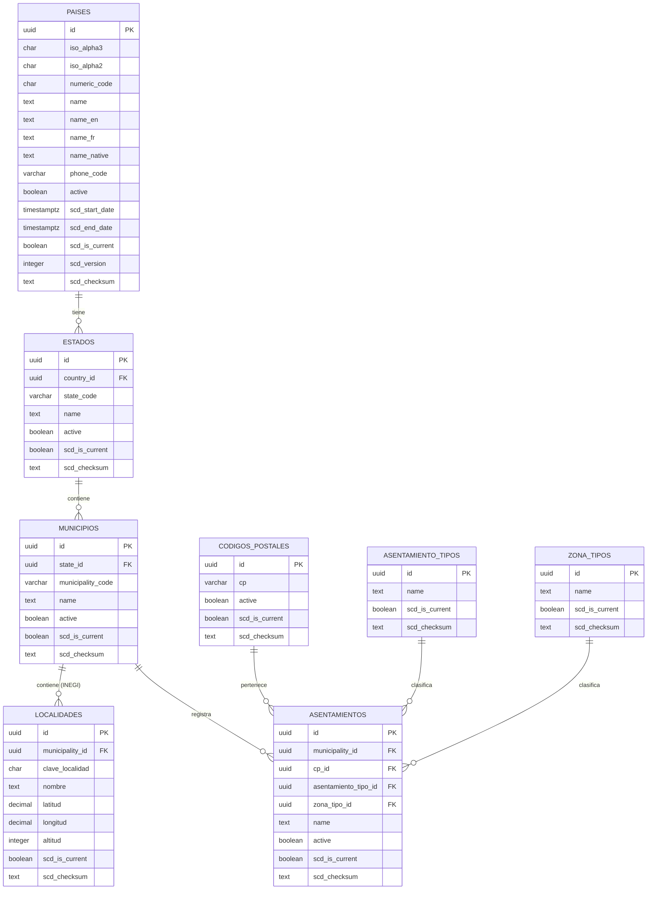

# Módulo Geográfico: SEPOMEX e INEGI (Aura Axioma)

Este documento detalla la estructura, el diseño y la justificación técnica del módulo geográfico del ecosistema, que unifica el catálogo postal de **SEPOMEX** con el catálogo estadístico y de coordenadas de alta precisión de **INEGI**.

---

## 1. Arquitectura y Justificación de Estructura

El módulo geográfico está dividido en dos esquemas de base de datos separados (`geo` e `inegi`) para aislar las responsabilidades y orígenes de datos:

1. **Esquema `geo` (SEPOMEX):**
   * **Propósito:** Alojar la jerarquía oficial de división política y de reparto postal (País → Estado → Municipio → Asentamiento/Colonia y Código Postal).
   * **Normalización:** Está altamente normalizado para evitar redundancia de datos. Tablas secundarias como `asentamiento_tipos` y `zona_tipos` agrupan propiedades comunes, y `codigos_postales` mapea de forma limpia las relaciones físicas de las colonias.

2. **Esquema `inegi` (INEGI):**
   * **Propósito:** Alojar la información geográfica física detallada (coordenadas de latitud y longitud, altitud) de las localidades mexicanas.
   * **Relación:** Se asocia a nivel de municipio con `geo.municipios(id)`. Esto permite cruzar la precisión estadística y satelital de INEGI con la base postal de SEPOMEX.

---

## 2. Diagrama de Entidad-Relación (ERD)

A continuación se muestra el modelo físico-lógico de las tablas y sus relaciones.

---

## 3. Detalle de Tablas

### Esquema `geo` (SEPOMEX)

#### 1. `geo.paises`
Almacena el catálogo global de países bajo el estándar ISO 3166-1.
* **Llave Natural:** `iso_alpha3` (Código de 3 letras como `MEX`, `USA`).
* **Traducciones y Nacionalidades:** Incluye traducciones multilingües para los nombres (`name_en`, `name_fr`) y campos específicos para la nacionalidad (`nationality_es`, `nationality_en`, `nationality_fr`, `nationality_native`), requeridos en los perfiles de usuario e interfaces del showcase.

#### 2. `geo.estados`
Entidades federativas (ej. Ciudad de México, Jalisco).
* **Relación:** `country_id` apunta a `geo.paises(id)`.
* **Código:** `state_code` es el número oficial de dos dígitos provisto por SEPOMEX (ej. `09` para CDMX).

#### 3. `geo.municipios`
Municipios o demarcaciones territoriales (ej. Miguel Hidalgo, Guadalajara).
* **Relación:** `state_id` apunta a `geo.estados(id)`.
* **Código:** `municipality_code` es la clave de tres dígitos del municipio dentro de su estado (ej. `016`).

#### 4. `geo.codigos_postales`
Códigos postales de 5 dígitos.
* **Índice único:** Protege el campo `cp` para evitar códigos duplicados en el mismo período histórico.

#### 5. `geo.asentamientos` (Colonias)
Asentamientos humanos detallados.
* **Relaciones:** Se enlaza de forma cruzada con:
  * `municipality_id`: Municipio al que pertenece.
  * `cp_id`: Código postal de la colonia.
  * `asentamiento_tipo_id`: Tipo de colonia (ej. Colonia, Fraccionamiento, Equipamiento).
  * `zona_tipo_id`: Clasificación de zona (ej. Urbano, Rural).

---

### Esquema `inegi` (INEGI)

#### 1. `inegi.localidades`
Ubicación de centros de población y localidades rurales/urbanas provistas por el INEGI.
* **Georreferenciación Física:** Contiene los campos `latitud` y `longitud` como decimales de alta precisión, y `altitud` sobre el nivel del mar en metros.
* **Relación:** `municipality_id` apunta a `geo.municipios(id)`.
* **Bypass de PostGIS:** Para evitar dependencias con extensiones externas que requieran archivos compilados ausentes en contenedores Docker básicos (como `postgis-3.so`), la georreferenciación inversa y búsqueda por radio se realiza usando la fórmula de distancia Euclidiana en SQL directo sobre los decimales de coordenadas.

---

## 4. Implementación de SCD2 (Slowly Changing Dimensions Tipo 2)

Todas las tablas en este módulo utilizan el estándar de **Dimensión que Cambia Lentamente Tipo 2 (SCD2)** para auditorías de datos históricos.

### ¿Por qué se diseñó de esta manera?
Las zonas postales, nombres de municipios e incluso las claves de las colonias pueden cambiar con el tiempo (por ejemplo, cambios de nombres oficiales, re-asignación de códigos postales o re-estructuración municipal). 
Para evitar corromper los registros históricos de transacciones o direcciones que dependían de los nombres antiguos, SCD2 crea una nueva fila para cada cambio en lugar de sobreescribir la existente.

### Columnas SCD2 utilizadas:
* `scd_start_date` / `scd_end_date`: Ventana temporal en la que el registro fue verídico.
* `scd_is_current`: Bandera booleana (`TRUE` o `FALSE`). Permite filtrar rápidamente los catálogos activos actuales mediante `WHERE scd_is_current = TRUE` sin lidiar con comparaciones de fechas complejas.
* `scd_version`: Número incremental que indica cuántas modificaciones ha sufrido esa fila específica.
* `scd_checksum`: Un hash MD5 de los campos clave. El script de sincronización (`SCD2Manager`) calcula este hash; si coincide con el de la base de datos, el registro no se actualiza, lo que acelera enormemente las importaciones consecutivas.
