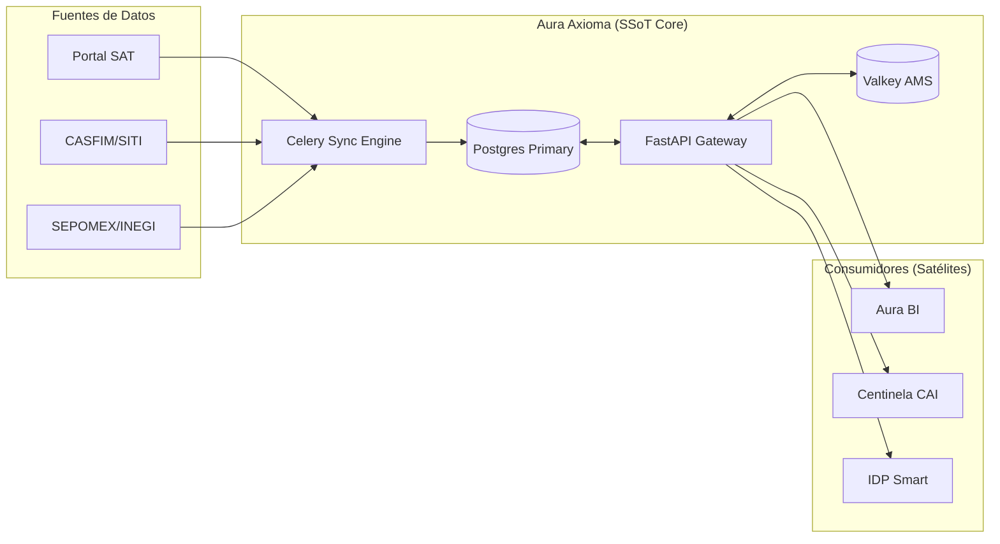
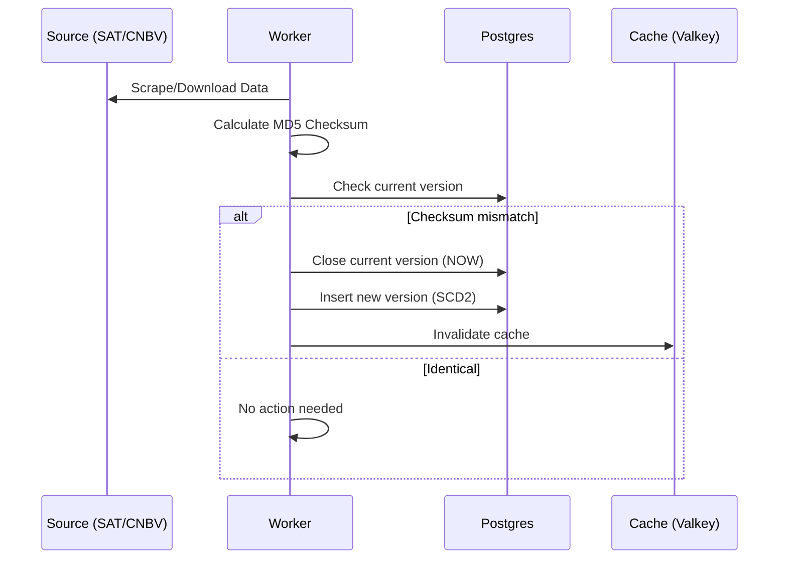

# Aura Axioma: Master Catalog Single Source of Truth (SSoT) 🚀

Aura Axioma es la piedra angular del ecosistema Casmarts, actuando como la **Fuente Única de Verdad (SSoT)** para todos los datos maestros. Su misión es centralizar, estandarizar y versionar los catálogos geográficos, fiscales y financieros utilizados por satélites como Aura BI, Centinela y IDP Smart.

## 📐 Arquitectura del Ecosistema



## 🛠️ Capacidades Smart

### 1. Ingesta Automatizada y AI-Powered Extraction
Axioma no solo almacena datos; los busca activamente. Mediante el **CasfimProcessor**, el sistema monitorea el portal de la SHCP, descarga los catálogos PDF oficiales y utiliza **Docling (AI Document Parsing)** para convertir tablas complejas en datos estructurados. Esto elimina la necesidad de carga manual y garantiza que los catálogos financieros estén siempre sincronizados con la fuente oficial.

### 2. Slowly Changing Dimensions (SCD2)
Mantenemos la soberanía histórica. Cada cambio en un código postal o una clave bancaria no sobreescribe el dato anterior, sino que crea una nueva versión con periodos de validez, permitiendo auditorías retroactivas. El `SCD2Manager` gestiona este proceso de forma transparente para el desarrollador.

### 3. Inteligencia Artificial (LangChain & Flowise)
Integrado con agentes de lenguaje natural para permitir el descubrimiento de claves y catálogos. Axioma expone sus datos a la capa semántica del ecosistema, permitiendo que agentes orquestados en **Flowise** realicen consultas inteligentes sobre la normativa y catálogos vigentes.

## 🔄 Flujo de Datos SCD2



## 🚀 Despliegue Rápido

El sistema está optimizado para correr dentro del `aura-network` de Casmarts:

```bash
docker compose up -d --build
```

## 📂 Organización de Esquemas
| Esquema | Contenido | Frecuencia Sync |
| :--- | :--- | :--- |
| `geo` | CPs, Asentamientos, Municipios, Estados | Mensual |
| `fiscal` | Catálogos Anexo 20 (SAT), Regímenes, Monedas | Semanal |
| `financial` | Bancos (CASFIM), Participantes SPEI, Tasas | Semanal |
| `calendars` | Festivos Nacionales, Jornadas | Anual |

---
**Casmarts 2026** - *Synergy between human talent and AI.*
